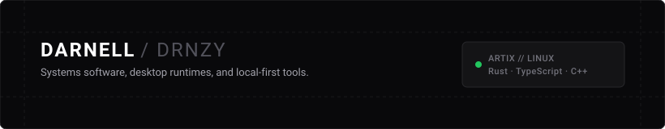
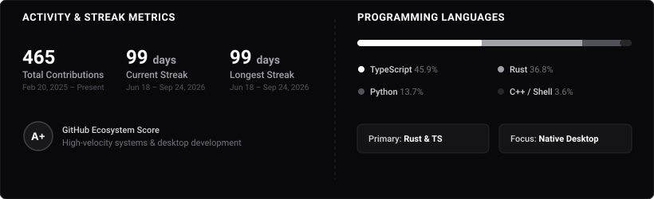

  

  
  
  
  
  
  
  
  

### Focus

* **Systems & Low-Level**: C, Modern C++ (C++20/23), Rust, Go, Linux system calls, PAM modules, dynamic linking, init systems (runit, dinit), Wayland protocols, and D-Bus IPC.
* **Academic Track (KU Leuven)**: Bachelor of Science in de Ingenieurswetenschappen (Burgerlijk Ingenieur), specializing in Computerwetenschappen / Electrical Engineering (ESAT) at Campus Arenberg. Targeting research in **COSIC** (embedded security, hardware root-of-trust, FPGA/ASIC side-channel attacks) and **DistriNet** (secure systems software, OS kernels, distributed edge runtimes).
* **AI Agent & Context Systems**: AST-based static code analysis over LLM token churn, zero-token BM25 semantic routing, progressive disclosure architectures, and local context indexing.
* **Desktop Runtimes & Media**: Wayland layer-shell protocols, Cairo vector rendering, DSP audio pipelines, and native Arch/Artix packaging.

### Activity

  

